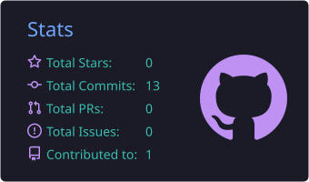
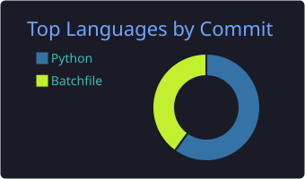
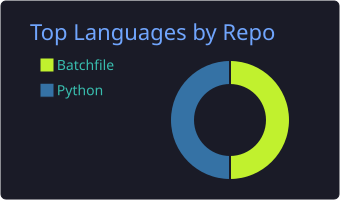
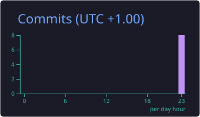

 

  

<h2 align="center">👋 À propos</h2>

🎓 Étudiant à **42 Paris**

💻 Je code principalement en **C** et je touche un peu à tout ce qui est outils, scripts et automatisation

🌱 Toujours en train d'apprendre, de tester et de construire de nouveaux projets

🤝 Ouvert aux échanges, aux idées et aux collaborations

 

<h2 align="center">🛠️ Stack & outils</h2>

  

<h2 align="center">📊 Statistiques GitHub</h2>

  

 

